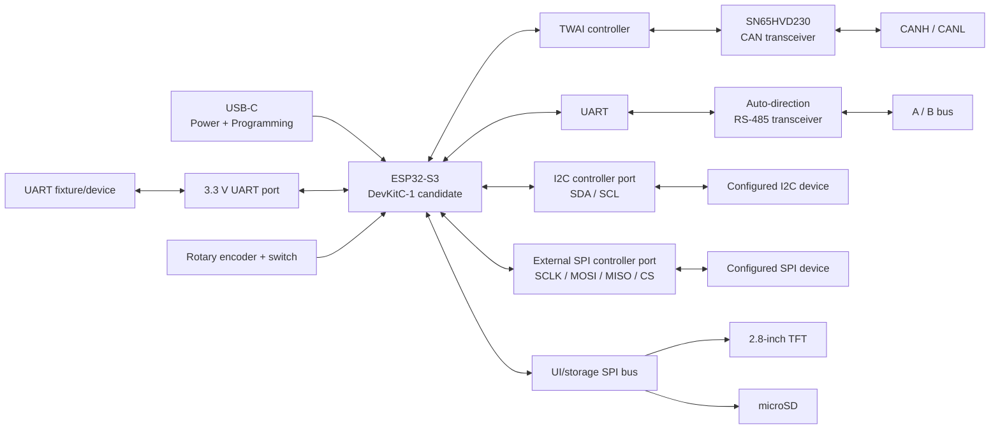

# System architecture

**Document status:** Preliminary Phase-0 architecture  
**Last updated:** 2026-11-10

## 1. Hardware block diagram



The external SPI port and the TFT/microSD bus are provisionally separated to
reduce bus-contention and route-testing risk. This consumes more pins but keeps
the externally routed SPI transaction independent of display/storage traffic.

## 2. Firmware layering

```mermaid
flowchart TB
    APP[Application\nUI, monitor, logger, configuration]
    ROUTER[Route registry and executor\nloop prevention, queues, counters]
    CODEC[Decoders -> validation -> mappings -> encoders]
    EVENT[Common event envelope\nplus protocol-specific metadata]
    DRIVERS[UART | TWAI/CAN | RS-485 | I2C | SPI drivers]
    HAL[ESP-IDF / hardware abstraction]
    HW[ESP32-S3 and external electrical interfaces]

    HW --> HAL --> DRIVERS --> EVENT --> CODEC --> ROUTER --> APP
    ROUTER --> DRIVERS
    DRIVERS --> APP
```

Pair-specific forwarding functions are intentionally excluded. A new route is
assembled from an existing source adapter, decoder, mapping, encoder, and
destination adapter.

## 3. Interface operating modes

| Interface | Initial role | Source-route meaning | Destination-route meaning | Not assumed |
|---|---|---|---|---|
| UART | Full duplex TX/RX | Receive a framed byte stream | Transmit a framed byte stream | Automatic message boundaries |
| CAN | TWAI node, TX/RX | Receive a filtered CAN frame | Transmit a configured CAN frame | CAN FD or arbitrary payload semantics |
| RS-485 | Half-duplex TX/RX | Receive framed UART data over the bus | Transmit framed UART data over the bus | Modbus RTU unless selected separately |
| I2C | Controller | Run a configured read/poll transaction | Run a configured write transaction | Passive sniffing or peripheral mode |
| SPI | Controller/host | Run a configured read transaction | Run a configured write transaction | Passive sniffing or device mode |

For I2C and SPI, a route source is active polling by ProtoScope, not unsolicited
receive traffic. The route configuration therefore needs an address/chip
select, transaction definition, and trigger or poll schedule.

## 4. Common-event design constraints

The future common event structure must contain a generic envelope and retain
interface-specific metadata. At minimum it needs:

- event and correlation identifiers;
- source interface and configured device identifier;
- monotonic timestamp;
- direction, status, and error code;
- payload reference and length;
- route provenance/hop count for loop prevention;
- UART/RS-485 framing metadata;
- CAN identifier, format, flags, and DLC;
- I2C address, read/write direction, register/command context, ACK/NACK state;
- SPI chip-select, mode, clock, word length, and transaction context;
- ownership/lifetime rules for buffers.

The abstraction must not force unlike protocols into a lossy byte-only record.

## 5. Route execution model

```text
source trigger/RX
  -> establish message or transaction boundary
  -> construct event with source metadata
  -> decode
  -> validate
  -> transform/map
  -> encode destination operation
  -> enqueue destination request
  -> transmit/execute transaction
  -> update counters and log result
```

An event that originated from a ProtoScope transmission carries route
provenance and must not re-enter a route as a fresh external source event.

## 6. Minimum monitor and logger behavior

The minimum live monitor state is:

- system state;
- selected route ID and source -> destination;
- interface availability;
- RX, TX, rejected, timeout, failure, and dropped counts;
- current/last error;
- SD/logging state.

The logger initially uses a boot-relative monotonic timestamp. It records route
input acceptance/rejection, mapping/transmit results, errors, queue overflow,
and storage health. A final schema and buffering design belong to Phase 8.

## 7. Power and electrical boundaries

- The wired prototype is USB-powered.
- USB is not a production data-conversion interface in the current scope.
- All ESP32-S3 GPIO signals are 3.3 V logic and are not 5 V tolerant.
- The CAN transceiver IC candidate is a 3.3 V device; the exact breakout module
  schematic and pin labels still require confirmation.
- RS-485, TFT, SD, and external fixture supply/logic details remain pending until
  exact modules are identified.
- A current budget and regulator-margin calculation is required before full
  integration.

## 8. Authoritative references used for the preliminary design

- [Espressif ESP32-S3-DevKitC-1 v1.1 user guide](https://docs.espressif.com/projects/esp-dev-kits/en/latest/esp32s3/esp32-s3-devkitc-1/user_guide_v1.1.html)
- [TI SN65HVD230 product documentation](https://www.ti.com/product/SN65HVD230)

Vendor pages for breakout boards are identification aids only; the exact board
revision and its own documentation must be checked before wiring.

